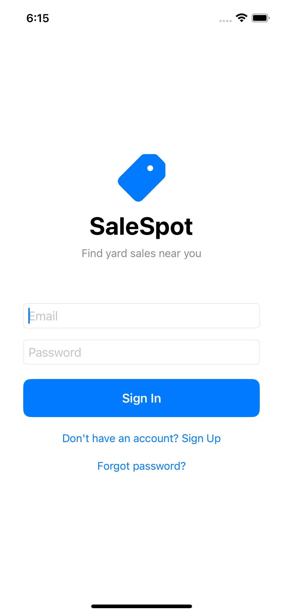
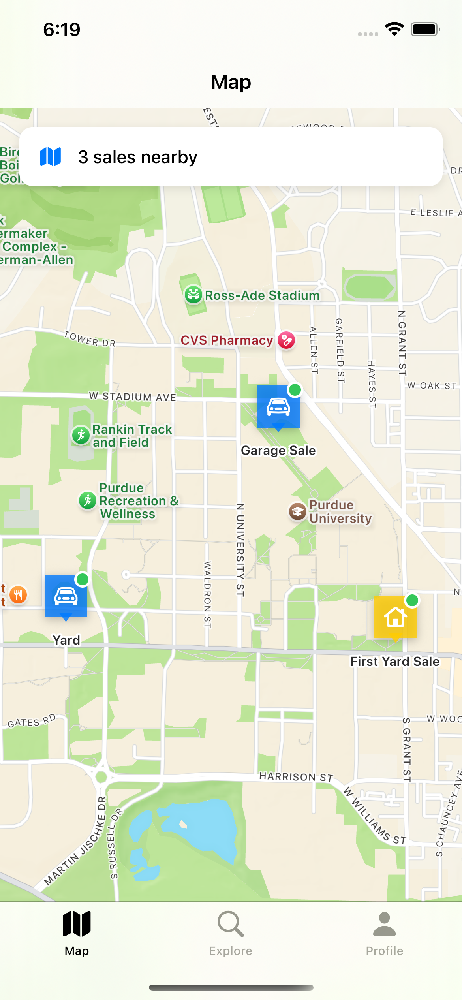
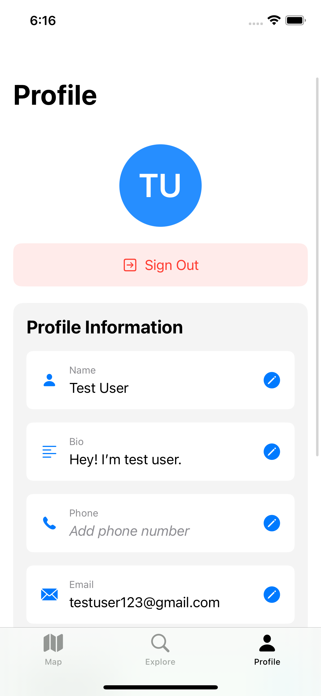
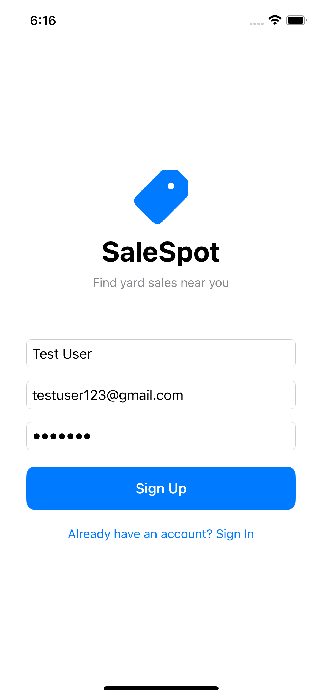
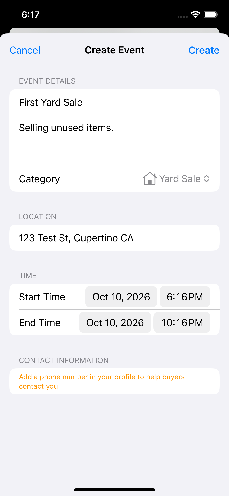
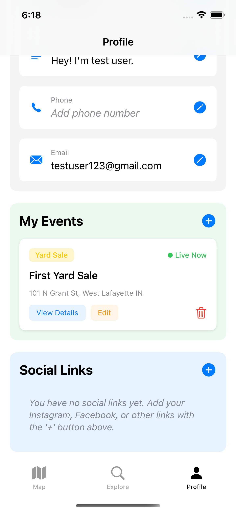

# SaleSpot

An iOS app for finding and posting nearby yard sales, garage sales, and other local sales on a map.

<p align="center">
  
  
  
</p>

## Features

- **Accounts:** email/password sign up, sign in, password reset, and sign out (Firebase Auth)
- **Map:** live sales as pins, with a nearby-sales count
- **Explore:** browse sales, filter by category, and sort by distance or time
- **Create events:** title, description, category, times, and a typed address that is geocoded onto the map
- **Profile:** initials avatar, name, bio, phone, email, social links, and a list of your events
- **Host profiles:** tap a host to see their public contact info

Sale types: Yard Sale, Garage Sale, Estate Sale, Moving Sale, Block Sale, and Other.

## Screenshots

| Sign in | Sign up | Profile |
| :---: | :---: | :---: |
|  |  |  |

| Create event | My events | Map |
| :---: | :---: | :---: |
|  |  |  |

## Built with

- SwiftUI
- MapKit and Core Location
- Firebase Authentication
- Cloud Firestore

## Run locally

1. Open `SaleSpot/SaleSpot.xcodeproj` in Xcode.
2. Select an iPhone simulator or device.
3. Make sure the Firebase `GoogleService-Info.plist` is in the Xcode project.
4. Press **Run** (`⌘R`).

## Project layout

```
salespot/
├── README.md
├── screenshots/          # app screenshots for this README
└── SaleSpot/             # Xcode project
    └── SaleSpot/         # Swift source
```
